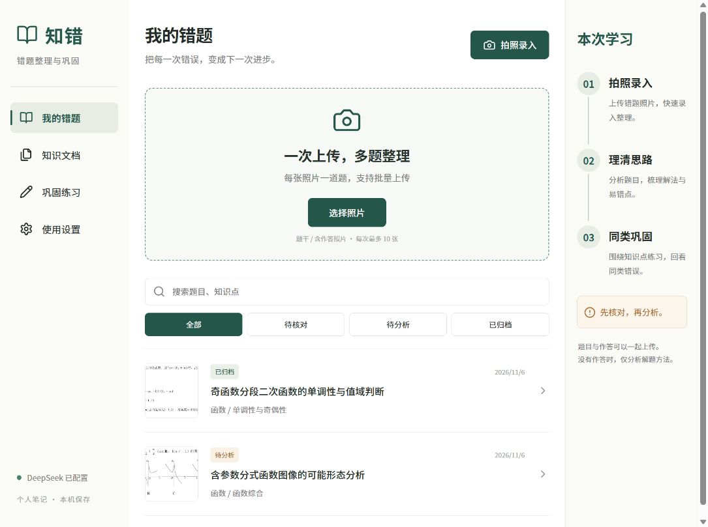

# 知错 · 高中数学错题本

手机适配的个人网站。在电脑运行，手机连接同一 Wi-Fi 使用。真实数据初始为空，没有演示记录混入题库。

## 产品介绍与截图

支持批量拍照录入、公式预览与人工核对、解题与错因分析、按知识点归档、同类练习和拍照批改。只有题干时提供解题方法；有作答时分析可见的错误步骤。图像选项和几何条件在分析时结合原照片读取。

- [图文产品介绍](docs/产品介绍/知错产品介绍.md)
- [PDF 介绍](docs/产品介绍/知错产品介绍.pdf) · [可编辑 Word 介绍](docs/产品介绍/知错产品介绍.docx)

介绍中的演示题目与批改状态已单独标注，不代表真实学生使用结果或提分效果。个人数据和密钥均不纳入仓库；仓库仅保留不含密钥的 `.env.example` 配置模板。

## 启动

需要 Node.js 22.13 或更新版本（当前开发环境为 Node 24）。首次使用在项目文件夹运行 `npm install`、`npm run build`，随后双击 **启动知错.cmd**。也可运行 `npm start`。保持运行窗口打开，按 Ctrl+C 关闭。

电脑访问启动窗口中的 localhost 地址；手机访问窗口中的局域网 IPv4 地址。电脑和手机需在同一 Wi-Fi，关闭会隔离设备的访客网络。若防火墙询问，仅对可信的专用网络允许 Node.js 访问；不要关闭防火墙。部分路由器禁止设备互访，此时先在电脑使用。

## 配置 DeepSeek

1. 将 `.env.example` 复制为 `.env`。
2. 在 `DEEPSEEK_API_KEY=` 后填写在 DeepSeek 官方开放平台创建的密钥，不加引号，不在聊天或代码仓库里分享。
3. 默认图片模型为 `deepseek-flash`，官方服务地址为 `https://api.deepseek.com`。可以通过 `.env` 更换模型；必须支持图片输入及 JSON 输出。
4. 重启网站，设置页会显示是否配置。**“已配置”仅表示存在密钥，不表示已验证余额、权限或识别效果**。上传一题进行实际验证。

图片能力依据 [DeepSeek 官方 Vision 文档](https://api-docs.deepseek.com/guides/vision/)。分析需要互联网和有效余额。没有密钥时，允许本地保存照片和手动核对，分析按钮不启用。图片、题干和作答会发送给 DeepSeek；调用按平台标准计费。原题识别、分析各调用一次；生成练习与复核各一次；练习识别和批改各一次，不自动循环重试。

## 使用流程

- **录入**：每张照片一道题，一次最多 10 张，每张最多 12 MB。支持 JPG、PNG、WebP；iPhone 的 HEIC 请先转换为 JPEG 或以兼容格式拍照。
- **识别与核对**：打开一题，识别后修正文字、公式与图形条件。可使用 `$...$` 输入行内 LaTeX，`$$...$$` 输入独立公式。保留原来的错误作答，勾选核对后分析；批量保存，逐题识别与确认。
- **分析**：没有作答时给出思路、步骤、答案和要点，不判断个人错因；有作答时引用错误步骤、解释并修正。缺条件或不能可靠求解时暂停归档。
- **归档**：按“章节—知识点”自动合并文档，内部按错因分组；可在原题详情修改分类。支持导出 Markdown，含题目、分析、要点以及已有练习和批改；照片保留在本机，不内嵌到导出文件。
- **巩固**：每道原题生成 3 道练习（基础、同类、进阶），经过第二次 AI 复核后保存。参考解默认隐藏，可主动查看。提交作答照片，核对识别文字，再批改。保留每次作答并记录重复错因，一次正确不等于掌握。
- **删除**：题目详情中的删除按钮会要求确认，并一并删除照片、分析、关联练习与作答，无法撤销。

## 本地数据与边界

- SQLite 数据库在 `data/notebook.sqlite`，已去除 EXIF 的照片在 `data/photos/`。关闭程序后复制整个 `data` 文件夹可备份，恢复时也需关闭程序。
- `.env`、`data`、依赖目录不会纳入 Git。API 密钥只由后端读取，不返回给手机。
- 这是可信家庭局域网中的单人版本，没有账号隔离、HTTPS 或公网认证。不要端口映射到公网，也不要在不信任的共享网络使用。
- 手写、几何图形与复杂公式可能识别错误。AI 的解释、出题复核和批改都可能出错，第二次复核不是数学正确性的保证；请结合教材、教师讲解核对。
- 拍照通过系统文件选择器完成，在普通局域网 HTTP 下也能选取照片；不依赖需要 HTTPS 的实时摄像头接口。

## 开发与验证

`npm run build` 构建前端；`npm test` 使用临时独立 SQLite 数据库和模拟模型响应验证工作流，不调用付费 AI，不往个人题库写示例。开发时运行 `node --env-file-if-exists=.env server/index.js --dev`。

技术：React / Vite、Express、Node 内置 SQLite、Sharp 图片校验与 EXIF 清理、Zod 结构校验、KaTeX 数学公式。单服务默认监听 `0.0.0.0:5173`，端口可通过 `.env` 修改。
