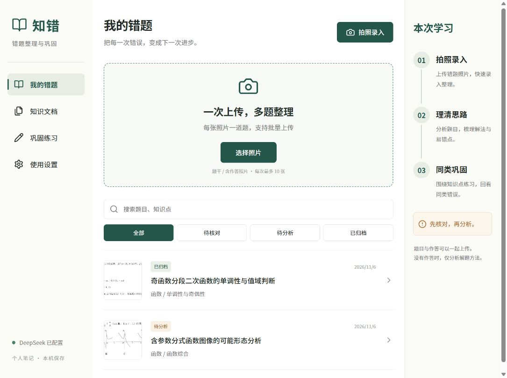
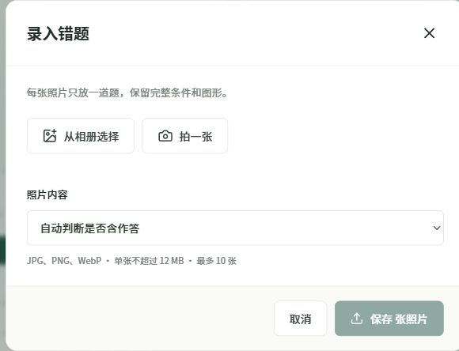
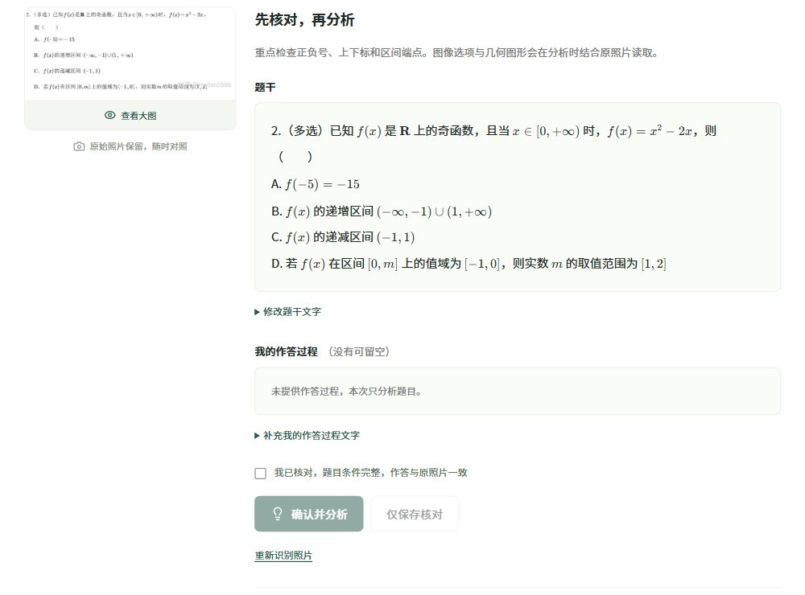
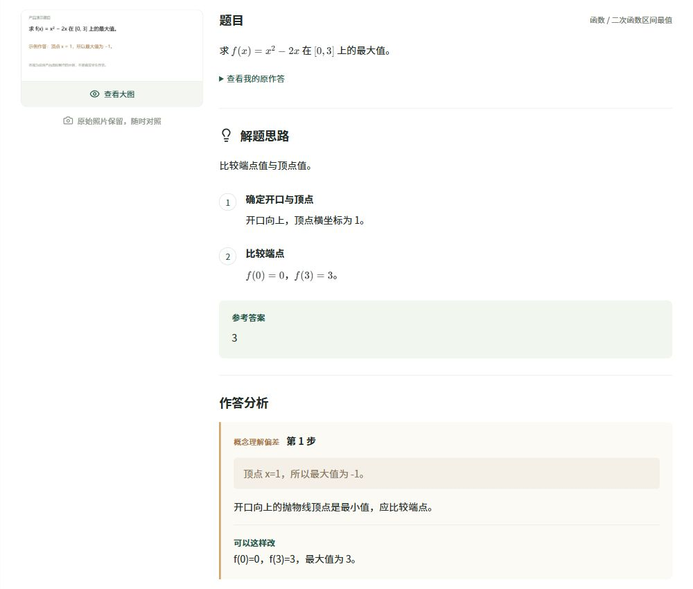
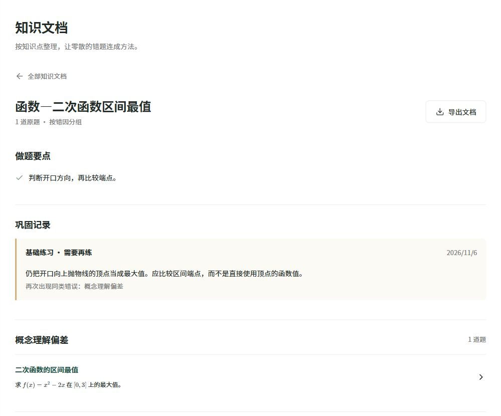
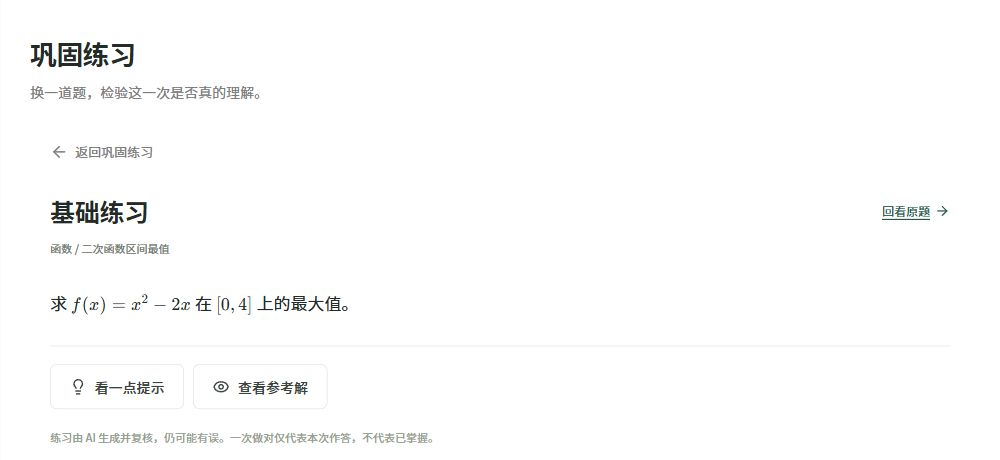
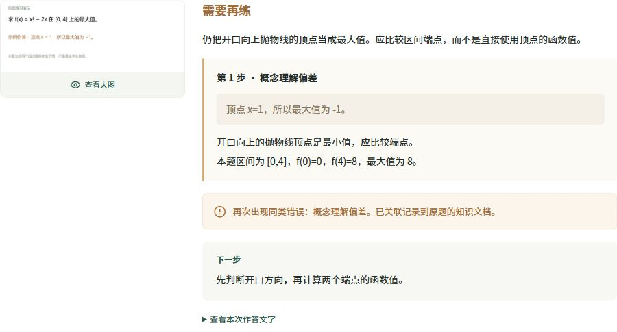
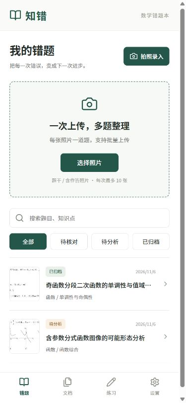

# 知错产品介绍

高中数学错题整理与巩固工具

版本 0.1 ｜ 2026年11月6日

版本 0.1   2026年11月6日

知错是一款面向高中生的手机适配网站。学生将错题拍照保存后，可以核对识别结果、查看解题思路与错误解释，再把题目按知识点归入文档，并通过同类练习检验理解。本文介绍当前版本的功能、使用流程和对应界面。

图1 我的错题主页  当前本地运行版本截图

### 适用场景

适合日常作业、试卷订正和考前复习：把分散在相册里的题目整理成可检索、可回看的知识文档。产品希望降低手动抄题与分类的负担，并帮助学生从“看过答案”走向“重新作答”。

## 功能与完整使用流程

截图说明：图1、图2、图8来自实际运行页面；图3在隔离展示题库中复现真实题目的核对状态；图4至图7使用预置演示数据，不代表真实学生作答、实时 AI 输出或学习效果。

| 功能 | 学生操作 | 产品输出 |
|---|---|---|
| 批量照片录入 | 从相册多选，或直接拍照 | 每张照片一道题，每次最多10张 |
| 识别结果核对 | 对照原图检查题干和作答 | 正常显示公式，可修改识别文字 |
| 解题与错因分析 | 确认内容后请求分析 | 思路、步骤、答案、要点及有依据的错因 |
| 知识点文档归档 | 查看或调整知识点分类 | 按知识点合并，文档内部按错因分组 |
| 同类题巩固 | 在原题详情点击开始巩固 | 基础、同类、进阶共3道练习 |
| 作答批改与回看 | 上传练习作答并核对 | 批改解释、再次出现的同类错因和历史作答 |
| 检索与文档导出 | 搜索、筛选或导出文档 | 快速回看错题，下载Markdown学习资料 |

### 从一张照片到一次复习

1 拍照录入  选择每张只含一道题的照片，可一次保存多张；随后逐题识别。

2 核对内容  对照原图检查公式、选项、区间和作答。修改后需重新勾选确认。

3 请求分析  AI结合核对文字与原照片解释解法；不清楚的条件需要先补充。

4 知识归档  题目进入对应知识文档，解题要点和错因随题目一起保留。

5 同类巩固  生成练习并进行AI复核，学生先在纸上完成，再主动查看提示或参考解。

6 提交与回看  上传作答、核对后批改；重复错因回写知识文档，供后续复习。

分析边界：只有题干时，提供解题方法，不推断个人错因；含学生作答时，才针对可见步骤解释错误。一次做对只表示本次作答正确，不直接标为已掌握。

## 拍照录入与公式核对

录入页面支持“自动判断”“只有题干”“含我的作答”三种照片内容。支持 JPG、PNG、WebP，单张不超过12 MB；当前不支持一张试卷自动拆成多道题。

图2 批量照片录入  实际运行页面截图

图3 公式核对与文字修改  真实题目在隔离展示题库中的界面

## 解题思路与错误解释

只有题干时，产品给出解题思路、关键步骤、参考答案和做题要点。含错误作答时，还会引用出错步骤，解释原因并展示修正方法。以下界面使用预置演示数据。

图4 解题步骤与错因解释  预置演示数据

### 示例中的分析方式

示例作答把开口向上抛物线的顶点当成最大值。产品将其归为“概念理解偏差”，指出顶点对应最小值，并引导学生比较区间端点。

错误解释与原步骤放在一起，便于学生知道哪里出错、为什么出错、应怎样修改。没有作答时，页面会明确说明本次不判断个人错因。

## 按知识点形成学习文档

知识文档以“章节—知识点”命名，例如“函数—二次函数区间最值”。同一知识点的题目自动合并，文档内部再按错因分组，方便集中复习同一类问题。

图5 知识文档与巩固记录  预置演示数据

### 文档中保留什么

文档集中展示做题要点、各错因下的原题，以及已完成的巩固批改记录。分类不准确时，可返回原题调整知识点；未提供作答的题目单独分组，避免将其当成已确认错因。

“导出文档”可下载Markdown文件，包含题目、思路、错因、要点及已有练习与批改记录。原照片继续保存在本机题库，当前不内嵌到导出文件。

## 同类巩固与作答批改

每道原题可生成基础、同类、进阶3道练习。参考解默认收起，学生可先独立完成，再查看提示或答案。以下练习与批改界面均使用预置演示数据。

图6 同类练习与提示入口  预置演示数据

学生上传作答照片并核对后，产品给出批改解释。若再次出现与原题相同的错因，系统会记录到对应知识文档；不确定的批改不会记录为已掌握。

图7 作答批改与同类错误提示  预置演示数据

## 手机使用与当前版本说明

网站适配手机浏览器。电脑运行服务，手机连接同一Wi-Fi后，通过局域网地址进入；底部导航提供错题、文档、练习和设置四个入口。

图8 手机端主页  当前本地运行版本截图

当前版本：面向个人本地使用，照片与学习记录保存在电脑。识别、分析和批改时，相关图片与文字会发送给DeepSeek处理；尚未提供多用户登录与公网服务。

验证说明：已完成10项自动测试及电脑和手机页面检查，并对一道图像选择题进行了真实DeepSeek调用验证。尚无真实学生使用研究、系统识别准确率评测或提分效果证明。AI解释、出题与批改仍可能有误，需结合教材或教师讲解核对。
